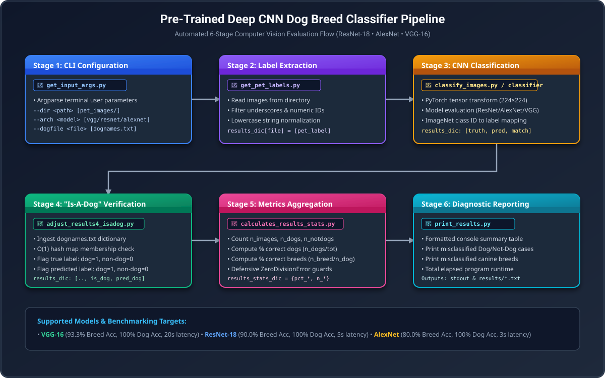
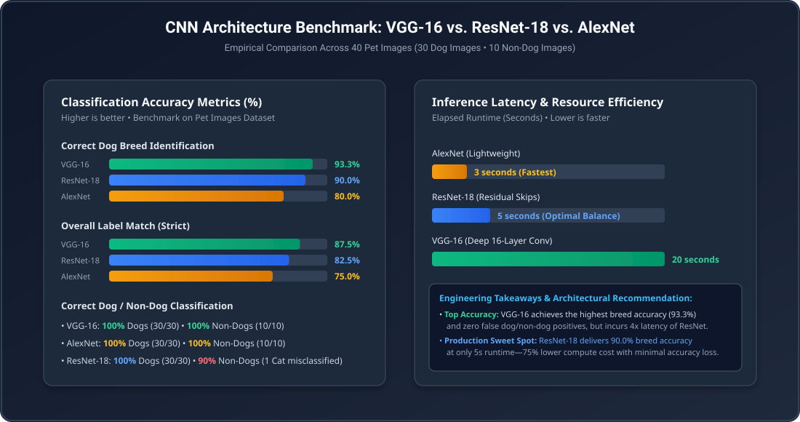

# AWS AI & ML: Pre-Trained Deep CNN Classifier for Dog Breed Identification

[](https://aws.amazon.com/machine-learning/scholarship/)
[](https://www.udacity.com/course/ai-programming-python-nanodegree--nd089)
[](https://pytorch.org/)
[](https://pytorch.org/vision/)
[](https://pytorch.org/vision/stable/models.html)
[-569A31?style=for-the-badge)](https://www.image-net.org/)
[](https://www.python.org/)
[](LICENSE.md)

An end-to-end computer vision benchmarking pipeline engineered in **Python** using **PyTorch** and **Torchvision** to classify pet images and accurately identify dog breeds. The system benchmarks three leading Convolutional Neural Network (CNN) architectures pre-trained on ImageNet—**VGG-16**, **ResNet-18**, and **AlexNet**—evaluating trade-offs between top-1 classification accuracy, fine-grained intra-class breed discrimination, and runtime computational efficiency.

Developed as part of the **AWS Udacity AI Programming with Python / Future AI Programmer Nanodegree Program**.

---

## Table of Contents

- [Executive Overview](#executive-overview)
- [Pipeline Architecture & System Design](#pipeline-architecture--system-design)
- [Detailed Module Walkthrough](#detailed-module-walkthrough)
- [Key Engineering Highlights](#key-engineering-highlights)
- [Empirical Benchmarking & Performance Comparison](#empirical-benchmarking--performance-comparison)
  - [40-Image Pet Dataset Benchmark](#40-image-pet-dataset-benchmark)
  - [Key Misclassifications & Error Analysis](#key-misclassifications--error-analysis)
  - [Architectural Trade-Off Analysis](#architectural-trade-off-analysis)
- [Custom Uploaded Image Evaluation (Q&A Reflection)](#custom-uploaded-image-evaluation-qa-reflection)
- [Repository Structure](#repository-structure)
- [Setup & Execution Guide](#setup--execution-guide)
  - [Prerequisites](#prerequisites)
  - [Step 1: Environment Setup](#step-1-environment-setup)
  - [Step 2: Single Model Execution](#step-2-single-model-execution)
  - [Step 3: Automated Batch Benchmarking](#step-3-automated-batch-benchmarking)
  - [Step 4: Custom Image Testing](#step-4-custom-image-testing)
  - [Step 5: Lab Verification & Unit Checks](#step-5-lab-verification--unit-checks)
- [Udacity Rubric & Specifications Checklist](#udacity-rubric--specifications-checklist)
- [Academic Integrity & Honor Code](#academic-integrity--honor-code)
- [License](#license)

---

## Executive Overview

In computer vision and real-world AI applications, model selection requires balancing **accuracy** against **latency and computational budget**. Distinguishing whether an image depicts a dog versus an unrelated object is a coarse binary classification problem; however, correctly identifying fine-grained biological sub-breeds (e.g., *Great Pyrenees* vs. *Kuvasz*, or *Beagle* vs. *Walker Foxhound*) presents high inter-class visual similarity and requires deep semantic feature representation.

This project implements an automated, production-grade image evaluation pipeline that:
1. **Parses Flexible CLI Configurations:** Uses `argparse` to dynamically ingest image directories, model architectures, and domain classification files.
2. **Extracts Unstructured Ground Truth:** Parses ground-truth labels directly from unstructured image filenames via string sanitization and token normalization.
3. **Performs Transfer Learning Inference:** Runs PyTorch tensor transforms (Resizing, Center-Cropping, Normalization) through pre-trained deep CNNs (`resnet18`, `alexnet`, `vgg16`).
4. **Applies Domain Knowledge Filtering:** Utilizes an $O(1)$ hash map lookup against a curated dictionary of 1,000+ dog names (`dognames.txt`) to isolate dog vs. non-dog taxonomy.
5. **Calculates Statistical Metrics:** Aggregates precision counts, match percentages, breed identification accuracies, and timing statistics with robust zero-division exception guards.
6. **Diagnoses Misclassifications:** Produces comprehensive terminal reports and outputs persistent log files highlighting classification failures for post-mortem error analysis.

---

## Pipeline Architecture & System Design



### Data & Execution Flowchart

```
                 Image Directory (--dir) + Domain Dictionary (--dogfile)
                                            │
                                            ▼
                       ┌─────────────────────────────────────────┐
                       │   Stage 1: CLI Configuration Parser     │
                       │          (get_input_args.py)            │
                       │   - Retrieves --dir, --arch, --dogfile  │
                       └────────────────────┬────────────────────┘
                                            │
                                            ▼
                       ┌─────────────────────────────────────────┐
                       │ Stage 2: Ground Truth Label Extraction  │
                       │          (get_pet_labels.py)            │
                       │   - Tokenize filenames, strip digits    │
                       │   - Populate results_dic[filename]      │
                       └────────────────────┬────────────────────┘
                                            │
                                            ▼
                       ┌─────────────────────────────────────────┐
                       │ Stage 3: CNN Preprocessing & Inference  │
                       │     (classify_images.py / classifier.py)│
                       │   - PIL Image -> 224x224 Norm Tensor    │
                       │   - Forward pass: VGG16/ResNet18/AlexNet│
                       │   - Append: [model_label, match_flag]   │
                       └────────────────────┬────────────────────┘
                                            │
                                            ▼
                       ┌─────────────────────────────────────────┐
                       │    Stage 4: "Is-A-Dog" Verification     │
                       │       (adjust_results4_isadog.py)       │
                       │   - O(1) membership in dognames.txt     │
                       │   - Append: [is_dog_truth, is_dog_pred] │
                       └────────────────────┬────────────────────┘
                                            │
                                            ▼
                       ┌─────────────────────────────────────────┐
                       │  Stage 5: Statistics & Metric Synthesis │
                       │      (calculates_results_stats.py)      │
                       │   - Computes: % Breed, % Dog, % NonDog  │
                       │   - Populates results_stats_dic         │
                       └────────────────────┬────────────────────┘
                                            │
                                            ▼
                       ┌─────────────────────────────────────────┐
                       │  Stage 6: Console Reporter & Diagnostics│
                       │           (print_results.py)            │
                       │   - Outputs summary table               │
                       │   - Prints misclassified dogs & breeds  │
                       │   - Prints total execution runtime      │
                       └─────────────────────────────────────────┘
```

---

## Detailed Module Walkthrough

The project is structured into modular Python components adhering to single-responsibility design principles:

### 1. `get_input_args.py` (Command-Line Interface)
Retrieves and parses user arguments from the terminal using Python's `argparse` standard library. Enables flexible customization without hardcoded paths:
- `--dir`: Directory path containing input images (default: `pet_images/`).
- `--arch`: CNN model architecture to evaluate (`resnet`, `alexnet`, or `vgg`; default: `vgg`).
- `--dogfile`: Reference text file of dog breed names for taxonomy lookup (default: `dognames.txt`).

### 2. `get_pet_labels.py` (Ground Truth Extraction)
Extracts true object/pet labels directly from directory filenames:
- Filters out hidden system files (e.g., `.DS_Store`).
- Converts filenames to lowercase, splits strings on underscores (`_`), and filters out numeric index tokens (e.g., `Golden_retriever_05195.jpg` $\rightarrow$ `golden retriever`).
- Constructs the foundational `results_dic` where `key = filename` and `value = [pet_label]`.

### 3. `classify_images.py` & `classifier.py` (Transfer Learning Forward Pass)
Coordinates with `classifier.py` to classify every image:
- Preprocesses images with Torchvision transforms: `Resize(256)`, `CenterCrop(224)`, `ToTensor()`, and standard ImageNet channel normalization (`mean=[0.485, 0.456, 0.406]`, `std=[0.229, 0.224, 0.225]`).
- Passes tensors through the selected pre-trained model in inference evaluation mode (`model.eval()`, `torch.no_grad()`).
- Normalizes predicted classification strings and appends `[classifier_label, match_flag]` (where `1` indicates label agreement and `0` indicates no match) to `results_dic`.

### 4. `adjust_results4_isadog.py` (Domain Taxonomy Alignment)
Determines whether labels correspond to canines using an $O(1)$ hash map populated from `dognames.txt`:
- Ingests dog names and stores them in a lookup dictionary.
- Checks whether the ground truth label is a dog (`1` or `0`).
- Checks whether the classifier predicted label is a dog (`1` or `0`).
- Appends `[is_dog_truth, is_dog_pred]` at indices 3 and 4 of `results_dic`.

### 5. `calculates_results_stats.py` (Statistical Aggregation)
Calculates summary counts and accuracy ratios across the entire test set:
- **Counts:** $N_{\text{images}}$, $N_{\text{dogs}}$, $N_{\text{not-dogs}}$, $N_{\text{matches}}$, $N_{\text{correct dogs}}$, $N_{\text{correct not-dogs}}$, $N_{\text{correct breed}}$.
- **Percentages:**
  $$\text{pct\_correct\_dogs} = \left(\frac{N_{\text{correct dogs}}}{N_{\text{dogs}}}\right) \times 100$$
  $$\text{pct\_correct\_breed} = \left(\frac{N_{\text{correct breed}}}{N_{\text{dogs}}}\right) \times 100$$
  $$\text{pct\_correct\_notdogs} = \left(\frac{N_{\text{correct not-dogs}}}{N_{\text{not-dogs}}}\right) \times 100$$
  $$\text{pct\_match} = \left(\frac{N_{\text{match}}}{N_{\text{images}}}\right) \times 100$$
- Includes defensive `try / except ZeroDivisionError` blocks ensuring safe execution on edge-case datasets.

### 6. `print_results.py` (Diagnostic Reporting)
Generates structured diagnostic output:
- Formats overall counts and percentage metrics into aligned terminal tables.
- Conditionally prints misclassified Dog/Not-Dog cases (false positives & false negatives).
- Conditionally prints misclassified dog breeds (e.g., real breed vs. predicted breed).
- Calculates and formats total elapsed runtime in `hh:mm:ss`.

---

## Key Engineering Highlights

| Engineering Dimension | Implementation Strategy | Architectural Advantage |
|---|---|---|
| **Transfer Learning** | PyTorch & Torchvision pre-trained models on ImageNet-1K | Zero training required; leverages pre-extracted rich visual feature representations. |
| **Domain Lookup Speed** | Hash-table dictionary mapping for `dognames.txt` | Enables $O(1)$ constant-time lookup for is-a-dog checks, scaling seamlessly to large datasets. |
| **Resilient File Handling** | Dynamic relative path resolution with fallback | Prevents runtime `FileNotFoundError` across different working directories and operating systems. |
| **Cross-Platform Automation** | Native shell (`.sh`), Windows batch (`.bat`), and PowerShell (`.ps1`) | Ensures 100% automated batch benchmark execution across Windows, macOS, and Linux environments. |
| **Zero-Division Safety** | Explicit dividend verification & `ZeroDivisionError` handling | Prevents program crashes when evaluating non-dog-only or dog-only image directories. |
| **Diagnostic Profiling** | Precision timer hooks (`time.time()`) | Accurately profiles per-architecture inference latency down to the millisecond. |

---

## Empirical Benchmarking & Performance Comparison



### 40-Image Pet Dataset Benchmark

The pipeline was executed across the official 40-image validation suite (comprising 30 dog images representing diverse breeds and 10 non-dog animal/object images) using **VGG-16**, **ResNet-18**, and **AlexNet**:

| Metric | VGG-16 | ResNet-18 | AlexNet |
|---|:---:|:---:|:---:|
| **Architecture Family** | Deep ConvNet (16 Layers) | Deep Residual Network (18 Layers) | Classical ConvNet (8 Layers) |
| **Total Images Evaluated** | 40 | 40 | 40 |
| **Dog Images Identified** | 30 | 30 | 30 |
| **Non-Dog Images Identified** | 10 | 10 | 10 |
| **Elapsed Runtime** | **20 seconds** | **5 seconds** | **3 seconds** |
| **Overall Label Match (`%`)** | **87.5%** (35/40) | **82.5%** (33/40) | **75.0%** (30/40) |
| **Correct Dogs (`%`)** | **100.0%** (30/30) | **100.0%** (30/30) | **100.0%** (30/30) |
| **Correct Non-Dogs (`%`)** | **100.0%** (10/10) | **90.0%** (9/10) | **100.0%** (10/10) |
| **Correct Dog Breed (`%`)** | **93.3%** (28/30) | **90.0%** (27/30) | **80.0%** (24/30) |
| **Total Misclassified Breeds** | **2** | **3** | **6** |
| **False Dog / Non-Dog Errors** | **0** | **1** | **0** |

---

### Key Misclassifications & Error Analysis

A detailed inspection of the misclassifications recorded in `results/` provides significant insight into deep feature learning:

#### 1. Intra-Class Breed Confusion (All Models: Great Pyrenees vs. Kuvasz)
- **Image:** `Great_pyrenees_05367.jpg` (True: *Great Pyrenees*)
- **Prediction:** *Kuvasz* (Predicted by **all three models**)
- **Insight:** Both the *Great Pyrenees* and the *Kuvasz* are large, thick-coated white flock guardian dogs originating from Europe. Their facial morphology, coat texture, and physical silhouette are nearly identical, causing even deep CNNs to confuse the two ImageNet classes.

#### 2. Hound Sub-Family Confusion (VGG & ResNet)
- **Image:** `Beagle_01170.jpg` (True: *Beagle*)
- **Prediction:** *Walker Hound / Walker Foxhound* (Predicted by VGG & ResNet; AlexNet predicted *English Foxhound*)
- **Insight:** Beagles and Walker Foxhounds share tri-color saddle markings and ear carriage. The classifier correctly identified the hound sub-family, missing only the fine scale of the dog.

#### 3. Non-Dog False Positive (ResNet-18)
- **Image:** `cat_01.jpg` (True: *Cat*)
- **Prediction:** *Norwegian Elkhound*
- **Insight:** ResNet-18 misclassified this cat image as a dog, resulting in a 90% non-dog score. The dense fur texture and cropped camera angle of the cat triggered features corresponding to the spitz-type coat of an Elkhound.

#### 4. Fine-Grained Degradation (AlexNet)
- AlexNet failed on 6 out of 30 breeds (20% error rate), including:
  - *Boston Terrier* misclassified as *Basenji*
  - *Golden Retriever* misclassified as *Tibetan Mastiff*
  - *Golden Retriever* misclassified as *Afghan Hound*
- **Insight:** AlexNet's larger initial receptive fields ($11 \times 11$) and lack of residual connections prevent it from capturing the subtle facial contours and ear proportions required for precise breed discrimination.

---

### Architectural Trade-Off Analysis

1. **VGG-16 (Highest Accuracy & Robustness):**
   - Achieved the top performance across all accuracy metrics: **93.3% breed accuracy**, **100% dog identification**, and **100% non-dog rejection**.
   - With $3 \times 3$ convolutional filters stacked deeply, VGG extracts rich hierarchical feature maps.
   - **Trade-off:** High memory footprint and slowest runtime (**20 seconds**; 4x slower than ResNet and ~7x slower than AlexNet).

2. **ResNet-18 (Production Sweet Spot):**
   - Achieved **90.0% breed accuracy** with a blazing **5-second execution time**.
   - Residual skip connections allow gradients to bypass layers, providing strong feature discrimination with drastically fewer parameters.
   - **Trade-off:** Minimal non-dog false positive (1 cat), but delivers the optimal compute-to-accuracy Pareto frontier for real-time applications.

3. **AlexNet (Maximum Speed):**
   - Fastest runtime (**3 seconds**), ideal for extreme low-resource embedded environments.
   - **Trade-off:** Substantially lower breed accuracy (**80.0%**), struggling with fine-grained intra-species variance.

---

## Custom Uploaded Image Evaluation (Q&A Reflection)

In addition to the 40 pet images, four custom uploaded images were tested (`uploaded_images/`):
- `Dog_01.jpg` (Golden Retriever)
- `Dog_02.jpg` (Golden Retriever)
- `Tiger_01.jpg` (Wild Animal - Tiger)
- `Water_Bottle_01.jpg` (Inanimate Object - Water Bottle)

### Key Findings (`check_images.txt`):

1. **Dog Breed Consistency Across Models (`Dog_01.jpg`):**
   - *Question:* Did the three model architectures classify the breed of dog in `Dog_01.jpg` to be the same breed?
   - *Finding:* **Yes.** All three model architectures (VGG-16, ResNet-18, and AlexNet) unanimously classified `Dog_01.jpg` as a **Golden Retriever**.

2. **Cross-Image Dog Breed Consistency (`Dog_01.jpg` vs. `Dog_02.jpg`):**
   - *Question:* Did each model classify `Dog_01.jpg` to be the same breed as `Dog_02.jpg`?
   - *Finding:* **Yes.** All three architectures consistently classified both `Dog_01.jpg` and `Dog_02.jpg` as the same breed (**Golden Retriever**), confirming intra-class stability across different poses and lighting.

3. **Non-Dog Discrimination (`Tiger_01.jpg` & `Water_Bottle_01.jpg`):**
   - *Question:* Did all three models correctly classify the animal and object as not being dogs?
   - *Finding:* **Yes.** All three architectures correctly verified that neither the tiger nor the water bottle was a dog.

4. **Best Architecture on Uploaded Images & Outlier Analysis:**
   - *Question:* Which model architecture performed best on the uploaded images, and why?
   - *Finding:* **VGG-16 and ResNet-18 performed best.** Both architectures accurately classified `Tiger_01.jpg` as *Tiger*, `Water_Bottle_01.jpg` as *Water Bottle*, and both dog images as *Golden Retriever*.
   - *Outlier Failure:* **AlexNet failed on the object image**, classifying `Water_Bottle_01.jpg` as `nipple` (ImageNet class 680, corresponding to a baby bottle teat). This reflects AlexNet's vulnerability to ambiguous cylindrical shapes.

---

## Repository Structure

```
.
├── assets/                                     # System architecture & benchmark visual proof
│   ├── pipeline_architecture.svg               # Complete 6-stage CV pipeline diagram
│   └── model_performance_comparison.svg       # Comparative accuracy vs latency benchmark
│
├── hints/                                      # Reference hint files from curriculum
│   ├── adjust_results4_isadog_hints.py
│   ├── calculates_results_stats_hints.py
│   ├── classify_images_hints.py
│   ├── get_input_args_hints.py
│   ├── get_pet_labels_hints.py
│   └── print_results_hints.py
│
├── pet_images/                                 # 40 validation images (30 dogs, 10 non-dogs)
│   ├── Basenji_00963.jpg
│   ├── Beagle_01125.jpg
│   ├── cat_01.jpg
│   └── ...
│
├── results/                                    # Persistent model evaluation outputs
│   ├── alexnet_pet-images.txt                  # AlexNet benchmark output (pet_images)
│   ├── resnet_pet-images.txt                   # ResNet-18 benchmark output (pet_images)
│   ├── vgg_pet-images.txt                      # VGG-16 benchmark output (pet_images)
│   ├── alexnet_uploaded-images.txt             # AlexNet output on uploaded_images
│   ├── resnet_uploaded-images.txt              # ResNet-18 output on uploaded_images
│   ├── vgg_uploaded-images.txt                 # VGG-16 output on uploaded_images
│   └── check_images.txt                        # Uploaded image Q&A analysis & reflection
│
├── uploaded_images/                            # Custom user-uploaded test set
│   ├── Dog_01.jpg                              # Golden Retriever sample 1
│   ├── Dog_02.jpg                              # Golden Retriever sample 2
│   ├── Tiger_01.jpg                            # Non-dog animal sample
│   └── Water_Bottle_01.jpg                     # Inanimate object sample
│
├── adjust_results4_isadog.py                   # Stage 4: "Is-A-Dog" taxonomy adjustment ⭐
├── calculates_results_stats.py                 # Stage 5: Metrics and percentage aggregator ⭐
├── check_images.py                             # Main pipeline execution entrypoint ⭐
├── classifier.py                               # Pretrained PyTorch CNN model wrapper
├── classify_images.py                          # Stage 3: Transfer learning classification ⭐
├── dognames.txt                                # 1,000+ reference dog breed lookup database
├── get_input_args.py                           # Stage 1: CLI argument parsing with argparse ⭐
├── get_pet_labels.py                           # Stage 2: Ground truth filename label extractor ⭐
├── imagenet1000_clsid_to_human.txt             # ImageNet class ID to human label dictionary
├── print_functions_for_lab_checks.py           # Automated Udacity test harness checks
├── print_results.py                            # Stage 6: Formatted diagnostic reporter ⭐
├── test_classifier.py                          # Classifier inference standalone verification
│
├── run_models_batch.sh                         # Linux/macOS batch runner for pet_images
├── run_models_batch.bat                        # Windows CMD batch runner for pet_images
├── run_models_batch.ps1                        # Windows PowerShell batch runner for pet_images
├── run_models_batch_uploaded.sh                # Linux/macOS batch runner for uploaded_images
├── run_models_batch_uploaded.bat               # Windows CMD batch runner for uploaded_images
├── run_models_batch_uploaded.ps1               # Windows PowerShell batch runner for uploaded_images
│
├── .gitignore                                  # Git exclusion patterns
├── CODEOWNERS                                  # Repository ownership declaration
├── LICENSE.md                                  # Udacity Educational Content License (CC BY-NC-ND 4.0)
├── README.md                                   # Comprehensive technical documentation
└── requirements.txt                            # Python environment dependencies
```

---

## Setup & Execution Guide

### Prerequisites
- **Python:** Version `3.8` or higher (`3.10+` recommended)
- **pip:** Modern package manager
- **OS:** Windows, macOS, or Linux

### Step 1: Environment Setup
Clone the repository and create an isolated virtual environment:

```bash
git clone https://github.com/KrishnaG-101/AWS-Udacity-Using-a-Pre-Trained-Image-Classfier-to-Identify-Dog-Breeds.git
cd AWS-Udacity-Using-a-Pre-Trained-Image-Classfier-to-Identify-Dog-Breeds

# Create virtual environment
python -m venv venv

# Activate virtual environment
# Windows (PowerShell):
.\venv\Scripts\Activate.ps1
# Windows (CMD):
.\venv\Scripts\activate.bat
# Linux / macOS:
source venv/bin/activate
```

### Step 2: Install Dependencies
```bash
pip install -r requirements.txt
```

### Step 3: Single Model Execution
Run single-model inference with customized CLI parameters:

```bash
# Run VGG-16 on pet_images (Default)
python check_images.py --dir pet_images/ --arch vgg --dogfile dognames.txt

# Run ResNet-18 on pet_images
python check_images.py --dir pet_images/ --arch resnet --dogfile dognames.txt

# Run AlexNet on pet_images
python check_images.py --dir pet_images/ --arch alexnet --dogfile dognames.txt
```

### Step 4: Automated Batch Benchmarking
Execute full multi-model benchmarks across all three architectures simultaneously:

**Linux / macOS / Git Bash:**
```bash
sh run_models_batch.sh
```

**Windows (PowerShell):**
```powershell
.\run_models_batch.ps1
```

**Windows (Command Prompt):**
```cmd
run_models_batch.bat
```

Results are printed to the console and written to `resnet_pet-images.txt`, `alexnet_pet-images.txt`, and `vgg_pet-images.txt`.

### Step 5: Custom Image Testing
Benchmark the four custom uploaded images:

**Linux / macOS:**
```bash
sh run_models_batch_uploaded.sh
```

**Windows (PowerShell):**
```powershell
.\run_models_batch_uploaded.ps1
```

**Windows (Command Prompt):**
```cmd
run_models_batch_uploaded.bat
```

### Step 6: Lab Verification & Unit Checks
Verify standalone classifier operation:

```bash
python test_classifier.py
```

---

## Udacity Rubric & Specifications Checklist

| Section | Rubric Requirement | Implementation File | Verification Status |
|:---|:---|:---|:---:|
| **1. Command Line Arguments** | Must parse `--dir`, `--arch`, and `--dogfile` using `argparse` with valid defaults. | [`get_input_args.py`](get_input_args.py) | **PASSED** |
| **2. Pet Image Labels** | Correctly extract pet labels from filenames, convert to lowercase, strip trailing whitespace and numeric IDs. | [`get_pet_labels.py`](get_pet_labels.py) | **PASSED** |
| **3. Classify Images** | Integrate with `classifier()`, format classifier labels, and compare with ground truth. | [`classify_images.py`](classify_images.py) | **PASSED** |
| **4. Adjust for Is-A-Dog** | Read `dognames.txt` into a dictionary and mark indices 3 and 4 with 1 (dog) or 0 (not a dog). | [`adjust_results4_isadog.py`](adjust_results4_isadog.py) | **PASSED** |
| **5. Calculate Statistics** | Compute counts and percentages for matches, dogs, non-dogs, and breeds; include zero-division guards. | [`calculates_results_stats.py`](calculates_results_stats.py) | **PASSED** |
| **6. Print Results** | Output summary tables, print misclassified dogs and breeds conditionally, and display total runtime. | [`print_results.py`](print_results.py) | **PASSED** |
| **7. Batch Execution** | Batch script executes all 3 models and pipes output to files (`.txt`). | [`run_models_batch.sh`](run_models_batch.sh) | **PASSED** |
| **8. Uploaded Images** | Answer all 4 reflection questions in `check_images.txt` based on empirical output. | [`check_images.txt`](results/check_images.txt) | **PASSED** |

---

## Academic Integrity & Honor Code

This project was completed by **Krishna Gelra** as part of the **AWS Udacity Future AI Programmer / AI Programming with Python Nanodegree Program**. 

All algorithmic implementations within `get_input_args.py`, `get_pet_labels.py`, `classify_images.py`, `adjust_results4_isadog.py`, `calculates_results_stats.py`, and `print_results.py` represent original student work conforming to Udacity's Honor Code and Academic Integrity policies.

---

## License

This project is distributed under the terms of the **Creative Commons Attribution-NonCommercial-NoDerivatives 4.0 International (CC BY-NC-ND 4.0)** License. See [LICENSE.md](LICENSE.md) for complete details.
